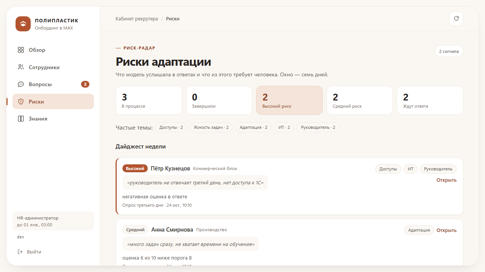
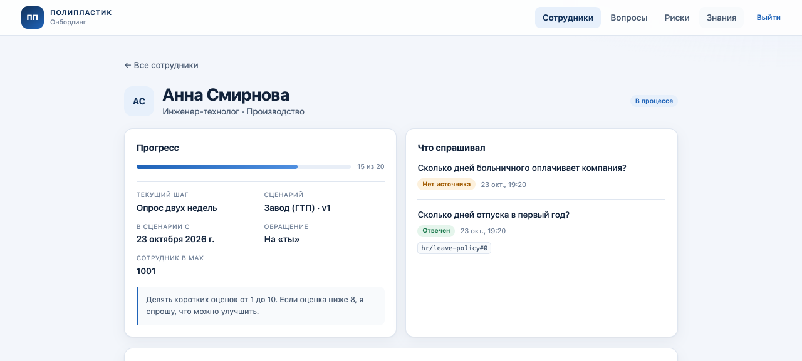
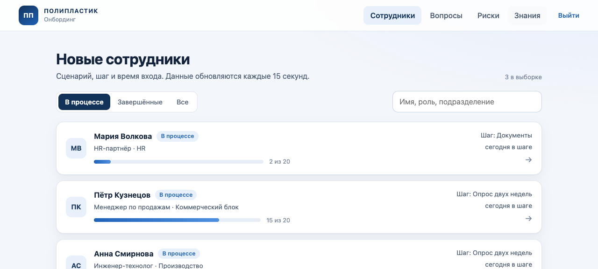
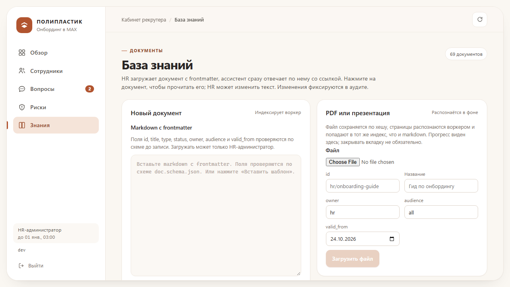

# MAX onboarding assistant

AI assistant for employee onboarding in the MAX messenger: onboarding scenarios for newcomers,
a recruiter cockpit, and a retrieval-grounded assistant over the company knowledge base.

Built for the "AI assistant in MAX" case (ООО «Группа ПОЛИПЛАСТИК»).

## Map

| Path | What | Mutable |
|---|---|---|
| `docs/` | architecture, contracts, decisions, runbooks, evals | yes |
| `knowledge/` | non-public company corpus served to the assistant | yes, with owner review |
| `apps/api/` | the service: webhook API, scenario engine, RAG, admin API | yes |
| `apps/admin/` | recruiter cockpit | yes |
| `docs/evals/` | golden set and its runner contract | yes |
| `infra/demo/` | demo employees for `make seed` | yes |

## Start here

| Question | File |
|---|---|
| What are we building and why? | `docs/architecture.md` |
| How do I work in this repository? | `AGENTS.md` |
| Where does a fact live? | `docs/README.md` |
| What is the bot allowed to answer? | `docs/product/answer-policy.md` |

## Quick commands

```bash
make install      # create the virtual environment
make check        # ruff, mypy, unit tests, docs links
make eval         # golden-set retrieval, generation, escalation
make ingest       # index knowledge/ into pgvector
make demo         # ingest + three employees, two real risk signals, three questions
make run          # api with reload on :8000
make worker       # job loop, outbox dispatcher, reminder tick
make cron         # one scheduler pass for reminders and the outbox (crontab-friendly)
make admin-install # cabinet dependencies
make admin-dev    # recruiter cabinet on :5173
make up           # postgres + migrate + api + worker + cabinet in docker
```

Offline demo in five minutes: [docs/product/demo-script.md](docs/product/demo-script.md).

## Status

Working end to end against a local Postgres with pgvector and a hosted model through OpenRouter:

- **MAX webhook**: secret check, `events` dedupe, durable job enqueue, `200` in milliseconds.
- **Scenario engine**: versioned YAML pinned per run, buttons, reminders, surveys with 10-point
  scales, escalation on timeout. Twenty steps from the welcome message to the end of probation.
  The employee row picks the branch, so the plant variant (`onboarding_plant`) is live, not dead
  content: its own transport copy and no remote-work question. The welcome asks «ты» or «вы»; the
  choice is stored on the run and switches the copy of later steps.
- **Retrieval**: frontmatter/JSON Schema corpus, deterministic chunking, pgvector HNSW + Russian
  `tsvector`, RRF, hosted rerank, audience and validity as SQL predicates. Every answer carries a
  citation from the retrieved set or escalates.
- **Answering**: one model call, JSON contract, prompt version `v3`; personal questions
  ("кто мой наставник", salary, contract) escalate instead of being answered with generic policy.
- **Risk radar**: after every survey the answer is classified (hosted model with a deterministic
  keyword fallback), rules turn signals into a level, tags, and Russian reasons, and the audit log
  records `risk_assessed` / `risk_escalated`. The cabinet shows a seven-day overview and a weekly
  digest of the signals that need a human.
- **Recruiter cabinet**: runs, per-employee detail with the audit timeline, question queue scoped by
  recruiter, manager (by department), or HR; a reply closes the question and leaves through the
  outbox; HR can offboard an employee; knowledge upload for HR with frontmatter validation.
- **Retention**: expired questions, uploads, outbox messages, and personal audit fields are purged
  hourly by the worker; `DATA_RETENTION_DAYS` is the policy knob; offboarding is immediate and
  audited. A claimed outbox row holds a lease, so a crashed worker loses no message.
- **Scheduler**: a cron entrypoint that shares the worker's building blocks, so reminders and the
  outbox are drained even when only a periodic job is running.



| Measurement | Result | Where |
|---|---|---|
| Golden set, 16 cases, real model | recall@5 1.00, MRR 1.00, citation 1.00, escalation 1.00, p95 2 237 ms, 0.077 ₽/answer | `docs/measurements/2026-10-23-eval-full-case-corpus.md` |
| Retrieval with rerank, 12 cases | recall@5 1.00, MRR 1.00 | `docs/measurements/2026-10-23-eval-full-answer-v3-gpt-4.1-mini.md` |
| Tests | 350+ unit and integration tests; `core/` purity enforced by a test | `apps/api/tests/` |







Known gaps, stated so nobody assumes otherwise:

- A real MAX bot token and the "MAX для бизнеса" verification are external dependencies. The
  adapter and the webhook are tested against the documented payloads and a local sender.
- File upload to MAX is not implemented; the scenario describes documents, the bot does not yet
  attach them.
- The retention window is a placeholder until the company's data protection policy confirms it.
  The mechanism is tested; the legal number is not ours.
- One worker replica: the MAX pacing state is in-process. More replicas need a shared limiter.
- The production model vendor must satisfy 152-ФЗ. The architecture keeps the provider behind a
  port; `docs/decisions/0010-one-model-vendor.md` records the current choice and what changes for
  an on-prem deployment.
- No production deployment has happened. Nothing here claims one.
