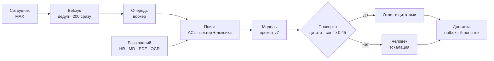
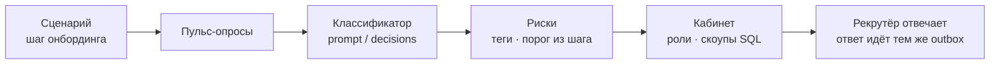

# Сквозной путь сообщения

Два контура: путь вопроса и продуктовая петля. Одна развилка — проверка обоснованности, и она
решает за модель. Шага, где модель выбирает сама, нет. Инварианты — в
[architecture.md](../architecture.md), прогон за десять минут — в [checker.md](../checker.md).

## Путь вопроса

От входящего события до доставки: очередь отделяет быстрый `200` от медленной генерации, а
проверка обоснованности стоит после модели, не до неё. Без цитаты из найденного фрагмента ответ
не уходит — вопрос получает человек.

## Продуктовая петля

Сценарий ведёт новичка по шагам. Ответы на пульс-опросы классифицируются, правила превращают
сигналы в риск, кабинет показывает то, что требует человека, а ответ рекрутёра возвращается в
мессенджер тем же `outbox`, что и ответы ассистента.

## Рычаги

| Рычаг | По умолчанию | Что меняет |
|---|---|---|
| `CHANNELS` | `max` | Telegram и VK включаются ключами канала |
| `LLM_PROVIDER` | `openai` | `gigachat`; демо-профиль compose ставит `extractive`, продакшен его запрещает |
| `EMBED_PROVIDER` | `hashing` в демо | настоящий эмбеддер вместо хешей |
| `RERANK_BASE_URL` | пусто | пусто — переранжирования нет, порядок гибридный |
| `BM25_ENABLED` | `false` | BM25 в пути запроса; выключен по ADR 0012 |
| `CONTEXTUAL_RETRIEVAL` | `false` | префикс контекста при индексации; выключен по ADR 0016 |
| `ANSWER_MIN_CONFIDENCE` | `0.45` | ниже порога — эскалация |
| `SENTIMENT_PROVIDER` | `auto` | `auto` берёт `decisions` с ключом классификатора, иначе `prompt`, иначе детерминированный `keyword`; выбрать можно только `decisions` и `prompt` (ADR 0029) |
| `EXTRACTION_PROFILE` | `native` | `doc-scan` включает OCR |
| `ADMIN_TOKENS` | три демо-роли | `token:role:subject[:дата]` — роль, субъект, срок |
| `DATA_RETENTION_DAYS` | `365` | окно хранения персонального |

Точные имена файлов и мест, где рычаг читается, — в
[architecture.md](../architecture.md) и `apps/api/onboarding/app/settings.py`.

## Чего схема не обещает

- **Задержка:** на полном наборе оба гейта провалены; конкретные числа и коммит — в
  [current.md](../measurements/current.md).
- **Демо:** отвечает `extractive`, эмбеддинги хеширующие, реранка нет.
- **Живой MAX:** адаптер проверен на задокументированных payload, верифицированного токена нет.
- **Вложения наружу:** входящие файлы хранятся под AES-GCM, отправка из бота не сделана.

## Как обновлять

Схема — это текст в этом файле, а не картинка: переименование стадии — правка строки в блоке
`mermaid`. Mermaid понимают GitHub, GitLab, VS Code и Obsidian; в просмотрщике без него виден
исходник, поэтому подписи пишутся так, чтобы читаться и как текст.

`make docs` проверяет, что блок `mermaid` закрыт, начинается с известного типа диаграммы, а
подписи с круглыми скобками взяты в кавычки — самая частая поломка раскладки. Числа на схеме не
живут: качество и задержка — только в [measurements](../measurements/current.md).
