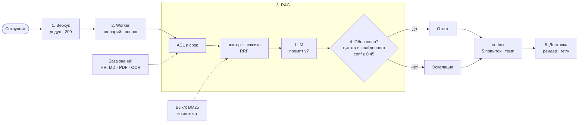

# Сквозной путь сообщения

Что происходит с сообщением сотрудника: пять стадий, две развилки, ни одного шага, где модель
решает вместо кода. Инварианты — в [architecture.md](../architecture.md), прогон за десять минут —
в [checker.md](../checker.md).

## Схема



Сплошная стрелка — путь, который работает. Пунктир — вход сбоку или рычаг, выключенный
в каждом развёртывании. Рычаги и их значения по умолчанию — таблица ниже.

## Рычаги

| Рычаг | По умолчанию | Что меняет |
|---|---|---|
| `CHANNELS` | `max` | Telegram и VK включаются ключами канала |
| `LLM_PROVIDER` | `extractive` в демо | `openai`, `gigachat`; `extractive` запрещён в продакшене |
| `EMBED_PROVIDER` | `hashing` в демо | настоящий эмбеддер вместо хешей |
| `RERANK_BASE_URL` | пусто | пусто — переранжирования нет, порядок гибридный |
| `BM25_ENABLED` | `false` | BM25 в пути запроса; выключен по ADR 0012 |
| `CONTEXTUAL_RETRIEVAL` | `false` | префикс контекста при индексации; выключен по ADR 0016 |
| `ANSWER_MIN_CONFIDENCE` | `0.45` | ниже порога — эскалация |
| `SENTIMENT_PROVIDER` | `prompt` | `jev` за флагом и с ключом |
| `EXTRACTION_PROFILE` | `native` | `doc-scan` включает OCR |
| `ADMIN_TOKENS` | три демо-роли | роль, субъект, дата истечения |
| `DATA_RETENTION_DAYS` | `365` | окно хранения персонального |

Точные имена файлов и мест, где рычаг читается, — в
[architecture.md](../architecture.md) и `apps/api/onboarding/app/settings.py`.

## Чего схема не обещает

- **Задержка:** `p95_answer` 29 066 мс при гейте 8000 мс — оба гейта провалены и это записано в
  [current.md](../measurements/current.md).
- **Демо:** отвечает `extractive`, эмбеддинги хеширующие, реранка нет.
- **Живой MAX:** адаптер проверен на задокументированных payload, верифицированного токена нет.
- **Вложения наружу:** входящие файлы хранятся под AES-GCM, отправка из бота не сделана.

## Рендер для слайда

```bash
npx -y @mermaid-js/mermaid-cli -i docs/diagrams/end-to-end.md \
  -o docs/diagrams/end-to-end.svg -t neutral -b transparent
```

SVG — производный артефакт, источник правды — этот markdown. Правишь стадию или рычаг — правишь
схему в том же коммите.
